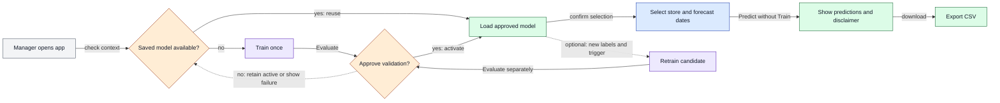
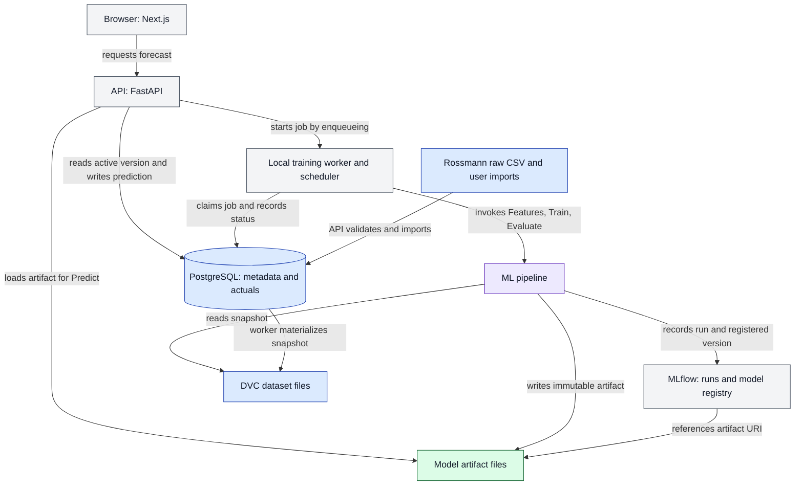

# Architecture

## In plain English
The browser asks a local API for forecasts. A saved model is reused instead of relearning on every request. A separate worker trains candidates while the approved model keeps serving. Historical data, predictions, and learned model files have different storage homes. No GPU or paid service is required.

Status: target architecture with phased implementation. API/web health, PostgreSQL ingestion, DVC normalization, cutoff-safe features, baseline evaluation and Phase 8 CPU model training/local MLflow tracking are implemented. Phase 9 adds PostgreSQL MLflow, verified model registration, transactional activation/rollback, inspection endpoints and a pinning domain interface. Phase 10 implements pinned saved-model prediction, transactional forecast persistence, discovery and CSV APIs; scheduling and forecast browser flows remain planned. See [data flow](DATA_FLOW.md), [lifecycle](MODEL_LIFECYCLE.md), and [diagram standards](DIAGRAM_STYLE_GUIDE.md).

## Vocabulary
| Term | Meaning |
|---|---|
| Data | Versioned historic observations and explicitly imported plans |
| Features | Model inputs derived only from information available at cutoff |
| Train | Learn fitted parameters from eligible historical labels |
| Evaluate | Compare predictions against withheld chronological labels |
| Approve | Validate and atomically select a serving version |
| Predict | Apply the saved model without fitting it again |
| Saved model | Immutable fitted parameters, preprocessing, and provenance manifest |
| Current predictions | Persisted results pinned to request, dataset, cutoff, and model |
| Training job | Durable work record, distinct from model approval |
| Forecast cutoff | Last business date whose observations may inform the forecast; not today's date |

## D1 — Manager journey

**Story:** Repeated predictions reuse an approved model; optional retraining is a separate action.
1. Establish initial dataset/cutoff/algorithm context to check compatibility. Final store/date confirmation follows model loading in this simplified journey.
2. If needed, Train once and Evaluate. Approve only a passing candidate; failure waits for user action, not an automatic retry loop.
3. Confirm store and 1–48 target dates, Predict, show historical-data/non-causal promotion disclaimer, and export.
4. Optional retraining follows its own validation path while the existing active model continues serving.
**Inputs:** dataset, cutoff, store, horizon, algorithm, saved model or job. **Outputs:** real predictions, version identity, disclaimer, CSV. **Errors:** invalid dates, unsupported stores, failed training, missing artifact, or export failure are explicit; no fake results.

## D2 — Ownership and storage

**Story:** Components have separate owners; PostgreSQL stores model references, never fitted model bytes.
1. Browser requests reach API application services. Bounded inference calls the shared pipeline's Predict entry point and reads cutoff-safe actuals/plans from PostgreSQL.
2. API enqueues durable jobs; the separate worker invokes Features, Train, and Evaluate.
3. The pipeline records actual MLflow runs/registry entries and immutable local artifacts.
4. Explicit imports produce validated observations and matching immutable DVC snapshots; forecast requests never run DVC commands.
**Inputs:** requests, CSV/imports, approved artifacts, snapshots. **Outputs:** actuals, forecasts, jobs, runs, models. **Errors:** database outage, worker crash, invalid imports, registry failure, or corrupt/missing artifact fail visibly; partial candidates never serve.
**Restart:** database volumes, MLflow backend, model files, and dataset/DVC files persist. In-memory Features/model caches do not. Interrupted jobs reconcile rather than pretending to finish.

## Process boundaries and resource design
UI uses Next.js TypeScript, Tailwind/shadcn/ui and Apache ECharts; it has no database/training logic. FastAPI routes validate HTTP contracts and call typed application services. Data repositories enforce store/date/version/availability boundaries. Shared ML modules own Features, Train, Evaluate, and Predict; they have no HTTP or scheduler dependencies. Artifact adapters publish/load trusted local bundles; no arbitrary uploaded executable models.

A separate local Python worker/scheduler uses a PostgreSQL durable queue. A training child process isolates crashes/lifetime from API serving. One job runs at a time; leases and heartbeats expose stalled attempts. Do not add Redis/Celery or train in an API background task. These are planned boundaries, not implemented processes.

Use one pooled direct horizon-aware model per algorithm, not 48 models. Each example maps `(store_id, cutoff_date, horizon_days)` to Sales at `cutoff_date+horizon_days`. Lags/windows are anchored at cutoff; future calendar/plans require known-at-cutoff availability. Sample origins and batch horizon expansion instead of materializing every possible row. Models train sequentially on CPU; no GPU or Colab runtime is required.

Proposed named defaults: `training_concurrency=1`, `model_threads=2`, `auto_trials_per_algorithm=3`, `auto_budget_seconds=600`, `feature_batch_rows=50000`, `api_forecast_concurrency=1`, `max_job_attempts=2`. These are unmeasured caps, not guaranteed RAM/performance. Measure total PostgreSQL/MLflow/API/UI/worker usage on the 8 GB target. Prefer production UI builds for demos; fail clearly on resource exhaustion. Budget expiry requires a fully evaluated valid candidate, otherwise training fails.

## Model compatibility and reuse
A serving slot identifies dataset lineage, feature schema, algorithm selection, and cutoff policy. A compatible model supports the requested store/horizons, matches preprocessing/schema, passes checksum, belongs to the snapshot lineage, and has `training_label_end <= forecast cutoff`. Append-only validated descendant snapshots can supply newer inference history; corrected history creates a distinct lineage. Historical requests must never load models trained on later labels.

Explicit LightGBM/XGBoost choices never silently switch algorithms. Auto reuses its approved winner; training compares candidates under identical splits/budgets. Stale compatible models can Predict with a visible age warning; requests do not retrain them. Missing compatible models enqueue/coalesce an initial training job and return a durable waiting forecast.

## Planned API contracts — not code
All dates are ISO business dates; event timestamps are UTC ISO 8601. IDs are opaque strings. Errors: `{error: {code, message, details, request_id}}`; no secrets. Requests carrying Idempotency-Key return the original operation for identical payload and 409 for changed payload. Lists are paginated.

| Endpoint | Request and response contract |
|---|---|
| GET /api/v1/stores | query dataset_version_id; 200 `{stores:[{store_id,first_date,last_date}], next_cursor}` |
| POST /api/v1/imports | multipart file, import_kind actuals/store_metadata/plans, available_as_of; 202 `{import_id,status:queued}` |
| GET /api/v1/imports/{id} | 200 `{import_id,status,dataset_version_id?,issues,counts}`; failed import publishes no partial snapshot |
| POST /api/v1/forecasts | `{dataset_version_id,store_id,cutoff_date,horizon_days:1..48,algorithm:lightgbm|xgboost|auto}`; 201 completed or 202 waiting_for_model with forecast_id/training_job_id/status links |
| GET /api/v1/forecasts/{id} | `{forecast_id,status,dataset_version_id,store_id,cutoff_date,horizon_days,requested_algorithm,resolved_algorithm?,model_version_id?,training_job_id?,predictions:[{target_date,horizon_days,forecast_sales}],warnings,error?}` |
| GET /api/v1/forecasts/{id}/export | CSV matching persisted forecast; product-spec columns plus dataset_version_id; 409 unless completed |
| POST /api/v1/training-jobs | `{dataset_version_id,training_cutoff_date,algorithm,reason:initial|manual|scheduled}`; 202 `{job_id,status:queued}`; coalesce same active context |
| GET /api/v1/training-jobs/{id} | `{job_id,status,stage,attempt,run_ids,candidate_version_ids,error?,created_at,updated_at}` |
| GET /api/v1/model-versions | `{items:[{model_version_id,algorithm,approval_state,training_label_end,dataset_version_id,mlflow_run_id,metrics,artifact_status}],next_cursor}` |
| POST /api/v1/model-slots/{id}/rollback | `{target_model_version_id,expected_generation,reason}`; 200 `{active_model_version_id,generation}`; 409 stale generation, 422 incompatible artifact |
| GET /api/v1/history | query dataset_version_id/store_id/through_date/limit; `{observations:[{date,sales}],truncated}`; missing observations stay missing |
| GET /api/v1/evaluations/{version} | `{folds,aggregate_metrics,per_store_metrics,baseline_metrics,zero_sales_excluded,provenance}`; undefined metrics are null with explanation |
| GET or PUT /api/v1/retraining-schedule | PUT `{enabled,cadence:weekly|monthly|quarterly,timezone:UTC,anchor_at}`; response adds next_due_at,last_check_at,last_outcome |

Invalid input is 422, unknown IDs 404, state conflicts 409, unavailable storage/registry 503. Forecast statuses: waiting_for_model/running/completed/failed. Prediction arrays remain empty until completion, then contain exactly the requested daily horizon with finite non-negative values. On initial training success the worker resumes waiting requests; failure marks them failed. Every operation pins model/snapshot IDs. Do not invent progress percentages. Imports reject arbitrary paths and publish only after validation; content checksums support safe retries. Bind services to loopback by default.

## Entity and storage contract map
| Owner/entities | Responsibility |
|---|---|
| App PostgreSQL: imports, dataset_versions | validation status, source hashes, snapshot/lineage/parent, availability assumptions, schema and DVC reference |
| App PostgreSQL: stores, actuals, plans | version-aware store/date keys, Sales/Customers observations, known-at-cutoff plans, availability metadata |
| App PostgreSQL: training_jobs, job_attempts | pinned context, status, attempt, lease/heartbeat, new-label fingerprint, errors and UTC times |
| App PostgreSQL: model_versions, model_slots | MLflow IDs, artifact URI/checksum, schema, cutoff/coverage, approval and active pointer/generation; no model bytes |
| App PostgreSQL: forecasts, forecast_points | model/snapshot/cutoff, requested/resolved algorithm, state and persisted results |
| App PostgreSQL: retraining_schedules, lifecycle_events | schedule anchors/checks/skips, label watermark, approval/rollback audit |
| MLflow backend and registry | recorded runs/metrics/parameters, registered versions and operational links; not serving-pointer authority |
| Model artifact files | fitted estimator, preprocessing/category map, feature manifest, dependencies/seed, data hash, code revision, label cutoff, supported coverage, checksum |
| DVC files and objects | exact immutable training snapshot identity; Git later tracks small manifests, never raw files |

One Docker PostgreSQL instance hosts separate app/MLflow databases and credentials. Model bundles live in an ignored managed local artifact directory; configure MLflow to use/reference that location. Publish files first, record registry/run metadata second, then candidate metadata. A generation-checked PostgreSQL transaction approves the active pointer and audit. There is no cross-store transaction: reconcile incomplete publication idempotently and never serve partial candidates. MLflow aliases/tags mirror approval eventually; app model_slots is authoritative. No unapproved automated artifact deletion.

## Persistence and recreation
| Item | Must persist? | Recreation/recovery |
|---|---|---|
| Original imports and availability assumptions | Yes | user data may be irreplaceable; Kaggle requires access again |
| App PostgreSQL volume | Yes | actuals, jobs, active pointer, predictions, audit need backup |
| MLflow backend | Yes | repeated training cannot recreate original run/registry audit |
| Approved/archived model files | Yes | exact bytes needed for reload/rollback; training may differ |
| DVC objects and manifests | Yes unless verified backup exists | manifests alone cannot restore missing data; local cache is not external backup |
| Materialized validated snapshots | Conditional | rebuild only from retained originals and pinned transform, then verify hash |
| Temporary Features/model cache/UI builds | No | recreate from pinned inputs/source; forecast audit still persists |
| Worker process/lease | No process persistence | expire lease, mark interrupted, retry as a new audited attempt |

## Non-diagram example
A manager imports historical Rossmann data and chooses July 31, 2015, a store, LightGBM, and a seven-day horizon. With no suitable model the worker trains only on labels available by that cutoff, evaluates earlier chronological folds, and approves only a valid candidate. The model directly predicts August 1–7 using July 31/earlier observed sales and documented known-at-cutoff calendar/plans. A second request reuses it without training. A later explicit label import can enable optional retraining while the active model keeps serving. This is an illustrative journey, not a measured run or accuracy claim.

## Risks and later checks
Measure RAM/CPU, select exact dependency pins, test snapshot parity and cutoff invariance, validate idempotency, restart recovery, concurrent approval/rollback, missing artifacts, and prediction during training. Historical availability assumptions and cross-store backup/reconciliation require explicit verification. No runtime readiness is claimed.

## Phase 3 boundary refinement
The sole installable Python package root is src/retailforecast. services/api/main.py is a top-level service adapter loaded by Uvicorn with --app-dir, not a duplicate domain package. scripts/manage.py supervises two logical local services; framework child processes are implementation details, not extra infrastructure. The browser uses a same-origin Next.js proxy to avoid introducing unnecessary CORS configuration. A future training worker remains unimplemented. Infrastructure is separately managed and not required for liveness.

## Phase 4 implemented storage boundary
PostgreSQL now runs alone in digest-pinned Docker Compose; API/web and CSV ingestion remain host processes. SQLAlchemy models, Alembic migrations, Pydantic source/request/report contracts and synchronous validate-first CLI ingestion are implemented. The physical actuals table is daily_sales; unlabeled competition plans are forecast_inputs; forecast request metadata is forecast_runs. sample_submission is a preserved/validated export template only. DATA_DICTIONARY.md maps source fields and normalized entity keys; INGESTION.md defines transactions and commands.

Creating MLflow's separate backend is deferred until its service exists (decision 0005). DVC snapshots, serving-slot generations/audit, HTTP upload endpoints, job workers, model lifecycle execution and forecasting remain planned. A partial unique model scope index enforces the minimum one-active constraint without pretending approval/rollback services are implemented. Forecast point model/cutoff/created-at fields are inherited through their normalized parent run.

## Phase 5 file artifact boundary
DVC now versions raw and normalized files independently of PostgreSQL. configs/data.yaml selects synthetic/real profiles; validation yields typed Parquet, receipts and portable manifests. Git tracks code/config/pointers, SQL owns transactions, and future MLflow owns runs/model references. Only ignored config.local contains the outside-repository local remote path. See DATA_VERSIONING.md and decision 0006. No feature/model/scheduler/API implementation is added.

## Phase 6 feature boundary

The shared features package implements direct 1..48-day rows for future training, backtests and inference. The verified Parquet adapter carries dataset identity and explicit knowledge-time assumptions. Metadata and target plans are as-of joins; future actual labels are attached only outside predictors. Training-fitted preprocessing is serializable JSON and never refitted at serving. FEATURES.md, FEATURE_REGISTRY.md and decision 0007 define this implemented boundary. No estimator, worker, scoring runner or HTTP feature/forecast endpoint has been added.

## Phase 7 offline evaluation boundary

ForecasterFactory/FittedForecaster protocols separate algorithms from the rolling-origin runner. Fit receives only cutoff/availability-filtered immutable history; prediction receives the shared FeatureRow. Scoring-only actual Sales/observed Open join afterward. Three deterministic baselines refit at each origin; all horizons reuse that frozen state. JSON/Parquet store real metrics, common-support coverage and source/fold provenance in ignored local artifacts. The final calendar is reserved before development selection and a guarded final release evaluates only a frozen winner. The real final period remains unscored in this phase. MODEL_STRATEGY.md and decision 0008 define scoring, failure and resource policies. No worker, model registry, new API/UI, database change or advanced training is added.

## Phase 8 CPU training boundary

A one-job coordinator supervises a native-fitting subprocess with CPU, sampled RSS and elapsed limits. Shared typed adapters fit XGBoost/LightGBM using per-fold preprocessing and one-hot categorical encoding. Bounded deterministic search/Auto use only development folds; baselines remain comparisons. A refit candidate is trained only through the reserved final origin, checksum-verified and renamed to a completed local model directory. The real final target window remains unscored. No database active pointer or serving API is implemented.

Local MLflow client logging uses SQLite metadata and filesystem artifacts under ignored artifacts/mlflow; no extra service is needed for this single-writer CLI. Decision 0009 refines the earlier PostgreSQL MLflow backend plan for this stage. Native models remain files, while metadata holds run/artifact references. TRAINING.md defines run/config/manifest contracts and the limited dev/full cohort scope.

## Phase 9 implemented lifecycle boundary

Decision 0010 supersedes historical Phase 4/8 notes above about deferred PostgreSQL tracking and SQLite production logging. One Docker PostgreSQL instance now holds distinct business/MLflow databases and credentials. New tracking uses PostgreSQL; existing SQLite experiments are preserved. Application registrations seal immutable bundles and reference MLflow run/model/version IDs. The global-v1 slot, generation and decision events control atomic replacement/rollback; ordinary reads/pinned models remain independent of a changing pointer.

Corrected promotion re-scores the original cutoff-fitted validation models, sealed to each registered recipe/final refit. Final models may include development dates after selection; they never generate earlier validation predictions. This uses the available labeled data without requiring manual approval. Exact serving-weight comparisons remain a separate post-fit evaluation path; all final holdout targets remain excluded. See decision 0011 and VALIDATION_FIX_REPORT.md. MODEL_LIFECYCLE.md is the implemented contract, including conservative same-context/schema/cohort compatibility. API inspection/activation/rollback exist; durable queue, scheduler, forecast browser flows, alias reconciliation and automatic orphan cleanup remain planned.

## Phase 10 saved-model serving boundary

The HTTP adapter delegates to ForecastService; it never owns training. One bounded request pins the global slot/version/generation, verifies the native/preprocessing bundle and obtains SQL history from its exact imported dataset. Query projection excludes Customers and future Sales before invoking the shared feature builder. Explicit known scenario revisions replace whole target plans. Evaluation and prediction share the existing output adjustment function.

Predict emits all store/horizon values before a single forecast_runs/forecast_points transaction. The run stores versioned request/provenance JSON and points retain exact rounded values and adjustment flags. Read/export reconstruct from persisted records without needing native files or MLflow availability. Daily/week/month totals sum stored store-day values. API_CONTRACT.md and decision 0012 define bounds, historical-date disclosures, schema errors, read-after-switch behavior and decimal-string contracts. The existing prediction diagrams describe this flow; browser flows, live ingestion, worker/scheduler and distributed serving are still deferred.
