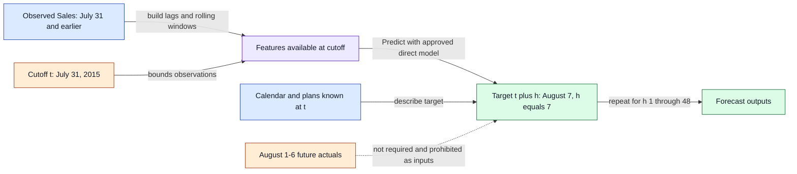

# Data and feature flow

## In plain English
History records what happened, while Features describe what the model was allowed to know. A cutoff separates available observations from future answers. Training learns earlier examples and evaluation checks hidden answers. Direct forecasts do not need intermediate future actual sales. Every input and transformation remains traceable.

## D3 — Data, Features, Train, Evaluate

```mermaid
flowchart LR
    R[Rossmann CSV and imports] -->|validate columns and grain| V[Schema validation]
    V -->|join by store and availability| J[Join store metadata]
    J -->|fit per training fold| M[Missing values and categories]
    M -->|derive cutoff-safe inputs| F[As-of Features builder: cutoff]
    X[Prohibited: future actual Sales and Customers] -.->|reject from Features| F
    F -->|partition forecast origins| B[Chronological backtest]
    B -->|fit folds then final candidate| T[Train model]
    T -->|Predict withheld targets| E[Test and record metrics]
    classDef data fill:#dbeafe,stroke:#1e40af,color:#111827;
    classDef transform fill:#ede9fe,stroke:#5b21b6,color:#111827;
    classDef approved fill:#dcfce7,stroke:#166534,color:#111827;
    classDef warning fill:#ffedd5,stroke:#9a3412,color:#111827;
    class R data;
    class V,J,M,F,B,T transform;
    class X warning;
    class E approved;
```

**Story:** Future answers are reserved for evaluation and cannot enter prediction inputs.
1. Validate columns/types, unique store/date keys, valid dates, non-negative Sales, and snapshot provenance. Invalid imports publish no dataset.
2. Join store metadata under an explicit availability rule, not future revisions.
3. Fit missing-value/category handling on each training fold only; reserve an unknown category and document missingness. This is a conceptual flow: preprocessing fit occurs inside folds, not globally before splitting.
4. Build origin-safe Features, partition chronological origins, Train fold models, Evaluate, and fit a final candidate through its declared training cutoff.
5. Record genuine metrics/baseline; lifecycle approval remains a separate gate.
**Inputs:** immutable CSV snapshot, metadata, label availability, origins, configuration. **Outputs:** fold-local preprocessing, Features, model candidate, metrics. **Errors:** duplicate rows, invalid dates/stores, ambiguous availability, insufficient history/label coverage, or leakage checks stop publication or yield explicitly declared coverage exclusions.

## D4 — Direct forecast timeline

**Story:** Predict August 7 using July 31's knowledge without waiting for August 1–6 actuals.
1. Set cutoff_date to 2015-07-31 and bound all observed inputs by that date and availability.
2. Compute store-specific lags/windows ending at cutoff; a seven-day inclusive window covers July 25–31.
3. Set horizon_days to 7 and target_date to 2015-08-07, adding target calendar and only plans known at cutoff.
4. Predict directly from the saved model; repeat independently for the requested horizons 1–48 without reading intermediate future actuals.
**Inputs:** cutoff-safe history, known plans/calendar, compatible model, horizon. **Outputs:** dated estimates and model/cutoff provenance. **Errors:** a model trained beyond cutoff, missing required history, or unavailable target inputs fails validation or uses a documented trained missingness policy; never future actual filling.

## Availability and provenance
Business dates stay dates; import/job events use UTC instants. Persist available_as_of separately. Historical Rossmann evaluation assumes labels are available by their selected daily cutoff; downloading a CSV today does not prove historical availability. Document assumptions for static metadata, holidays, and promotion plans; archived competition inputs are not proof of real-world knowledge at every origin.

Snapshots are immutable and content-addressed. Conflicting corrected history creates a new lineage, not an in-place overwrite. PostgreSQL actuals and DVC validated snapshots share version/hash identity. Feature manifests record name, source/version, store/date grain, transform, cutoff boundaries, lookback, availability rule, missingness policy, category vocabulary, and inference dependencies. Customers are excluded entirely from V1 predictors. Sales appear only as training labels or historical cutoff-safe lags/aggregates. Promotion inputs remain non-causal and known-at-cutoff only.

## Evaluation and output policies
Use three chronological development folds and a separate final 48-day holdout when coverage supports them; derive actual dates from coverage, never invent labels. Each fold's training labels must end at/before its origin even for expanded multi-horizon rows. Fit preprocessing within each fold. Compare algorithms and baseline on identical supported store/date masks and declared budgets. Choose hyperparameters/winner using development folds only; record untouched holdout performance without using it for selection. Distinguish fold/holdout artifacts from the deployment model refitted through the declared cutoff; never describe the refitted model as trained only on pre-holdout labels.

RMSPE excludes zero actual Sales and reports exclusions; MAE includes zeros. All-zero scored slices have undefined RMSPE, not a fake zero score, and cannot pass the RMSPE selection gate. Use a seasonal baseline repeating the latest observed same-weekday Sales available at origin; document any missing-history fallback and compare on common supported rows. Report per-store and aggregate metrics/coverage. Auto selects by mean development-fold RMSPE, then MAE, training duration, stable algorithm name. No eligible candidate means visible failure, not a hidden baseline fallback.

Known closure may force zero only when closure is documented as known at cutoff; never derive future closure from future Sales. Use the same documented non-negative clamp during evaluation and serving. Missing dates remain missing labels, not synthetic zero actuals. Technical approval requires finite metrics/predictions, reproducible artifacts, and complete declared supported coverage; it does not promise improvement over baseline. Display unfavorable comparisons honestly.

## Planned leakage checks
Hand-check July 31/August 7, horizons 1/48, inclusive windows, store isolation, and unknown categories. Mutating all post-cutoff Sales/Customers must not change Features or fixed-model predictions. Reject models trained beyond the requested cutoff. Test per-fold preprocessing and availability-aware joins. These are later implementation obligations, not executed tests in this phase.

## Phase 4 ingestion status
Source validation, versioned store joins, immutable raw-file preservation and PostgreSQL publication are implemented; D3's downstream feature preprocessing, backtests, Train/Evaluate are still planned. Missing required holiday flags are rejected rather than assumed zero. Versioned train actuals and unlabeled test inputs occupy separate tables; sample submission never supplies labels. Known-source quirks and full missingness/checksum reports are documented in DATA_DICTIONARY.md. No engineered features are produced by ingestion.
