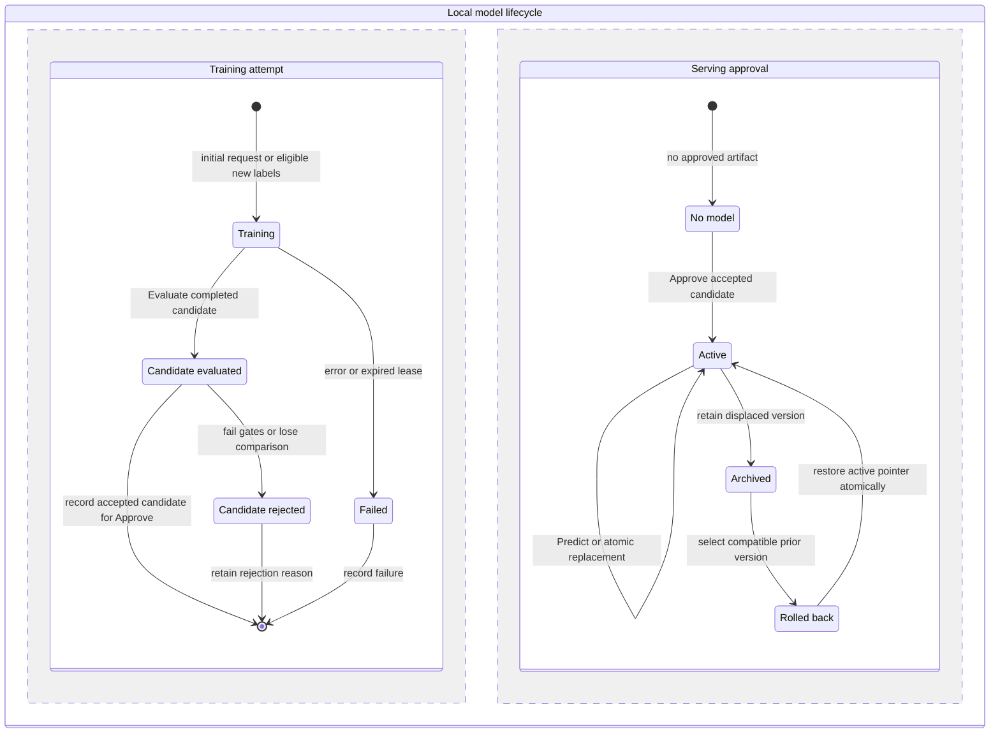

# Model lifecycle

## In plain English
Training can fail without damaging the model already in use. A successful attempt creates a candidate that must pass checks before approval. Predictions keep using the active version while replacements are evaluated. Schedules only check for new labels while the local worker runs. Rollback can restore a retained compatible model without training again.

## D5 — Work and approval are separate

**Story:** Training-attempt state and serving approval coexist; a new candidate never interrupts Active.
1. Initial training can begin without a model. Retraining requires new eligible labels and an explicit manual/scheduled trigger.
2. Evaluate candidates; failed gates or an Auto loser yield Candidate rejected. An eligible winner may be approved.
3. Approve changes the active pointer atomically, archiving the old version in the same transaction.
4. Predict pins the active version and never starts a training attempt.
5. Rollback verifies a retained model, records the Rolled back event, and restores its active pointer; the displaced model stays archived.
**Inputs:** snapshot/cutoff, algorithm, attempt state, candidate metrics/artifact, slot generation. **Outputs:** audited attempts, candidate decisions, active version, archived versions, rollback audit. **Errors:** training failure, missing/corrupt artifact, failed gates, registry outage, stale generation, or incompatible rollback leave the existing active model unchanged.
**Semantics:** The lower lane summarizes per-version roles, not a global slot becoming empty. Active-to-Archived means the displaced version; a replacement becomes Active atomically. Rolled back is an audit event, not a second active slot. Upper-lane completion alone never authorizes serving.

## Attempt versus model states
Attempt status: queued/running/succeeded/failed/interrupted/cancelled. Running stages: Features, Train, Evaluate, publish. Success may still produce rejected models, such as the losing Auto candidate. Model approval roles: candidate/active/rejected/archived. Rolled back records an event changing those roles; No model is an absent active pointer, not an empty artifact.

Worker claims use durable leases/heartbeats and one child training process. Startup expires dead leases and marks attempts interrupted before retry. Each retry is a new audited attempt; max_job_attempts defaults to 2. Coalesce identical initial training requests; active-model prediction does not enqueue training. Manual/scheduled retraining needs new eligible labels; failed initial jobs can retry the same data.

## Publication, approval, rollback
1. Pin snapshot/hash, feature version, code revision, seed, dependencies, label cutoff, supported stores/horizons, and algorithm policy.
2. Record real chronological evaluation and baseline results; require validity/coverage and artifact checks. Passing gates is not a promised accuracy gain.
3. Write a temporary bundle, verify reload/checksum, and rename atomically on the same filesystem into its immutable final directory.
4. Record MLflow runs/registered version and link operational candidate IDs. Partial publication remains non-serving and is reconciled idempotently; no cross-store transaction is assumed.
5. In one PostgreSQL transaction lock the slot, check expected generation, archive the old version, update the active pointer, increment generation, and write the event. Passing initial/manual/scheduled candidates use this same documented gate-based automatic promotion policy.
6. Existing requests finish with pinned IDs; new requests load the replacement. Bound the API model cache and never mutate model bytes in place.

Rollback checks schema, lineage, cutoff, coverage, and checksum before a generation-checked atomic pointer update. Require idempotency and a reason; retain the displaced artifact. Do not substitute a newly trained model for lost historical bytes. PostgreSQL model_slots is serving authority; MLflow aliases/tags mirror it through reconciliation.

## Local scheduling
Disabled by default. Cadences are weekly/monthly/quarterly using a persisted UTC anchor. Month/quarter dates clamp to the last valid day but future dates derive from the original anchor to avoid drift. The worker must run; sleep/shutdown prevents scheduled execution. On restart coalesce missed occurrences into one check and advance next_due_at into the future; no cloud uptime promise.

Compare validated observed-label fingerprints/coverage to the last accepted training snapshot for that context. New plans alone do not count. With no new eligible labels, record skipped_no_new_labels. Invalid imports never trigger training. Scheduled jobs use the newest eligible label date; historical forecasts still enforce their own cutoff. Atomic locks/idempotency prevent overlap; a due check during running training records deferral/coalescing rather than starting another process. Corrected history creates a new lineage and requires explicit context selection, not a silent replacement.

## Later tests
Verify Predict during candidate failure, artifact corruption, stale generation, no-new-label skips, month/leap-year anchors, missed-run coalescing, and publication interruptions between filesystem/registry/database writes. Pin requests across activation and reject models trained beyond forecast cutoff. These are planned obligations, not executed application tests.
