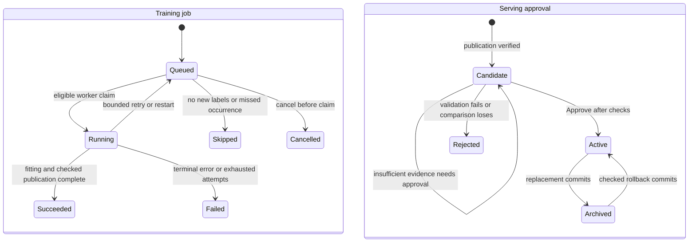

# Model lifecycle

## In plain English

A training run records an experiment. A model version identifies verified, saved weights and preprocessing. PostgreSQL selects one active version; MLflow organizes its experiment and registered-model references. Failed candidates cannot remove the current model. Earlier model files remain available for checked rollback.

Phase 9 implements local tracking, candidate registration, shared-window comparison, generation-checked activation, rollback, model inspection and a request-pinning domain interface. Phase 10 adds forecast HTTP execution; Phase 11 adds durable local jobs, scheduling and minimal training onboarding. Full model/forecast browser pages remain future work.

## D5 — Attempts and serving approval



**Story:** Finishing an experiment creates a candidate, not an active serving pointer.

1. Train and Evaluate use chronological development labels and preserve final targets.

2. Register validates and copies immutable local files, records MLflow references, then writes the candidate.

3. Approve locks the global slot, checks its generation and evidence, then replaces roles/pointer/audit together.

4. Predict can pin a loaded model before replacement; that object and its model ID remain unchanged.

5. Rollback restores a checked archived version with a reason; it does not train again.

**Inputs:** completed training bundle, dataset lineage, schema, saved metrics, shared windows and expected slot generation. **Outputs:** candidate/active/rejected/archived roles, active pointer and decision audit. **Errors:** corrupt/missing files, incompatible lineage/schema, stale generation, missing evidence or transaction failure retain the incumbent. Candidate validation failures are audited as rejected; invalid archived rollback targets remain archived. Concurrency is serialized only for lifecycle mutations; pointer readers see the previous committed version until replacement commits. The job region tracks durable requests; retries retain separate attempt audit. A succeeded fit may leave its candidate rejected or pending, so job success and active approval are distinct. The separate scheduler and process supervision are detailed in TRAINING_JOBS.md. Active-to-Archived and Archived-to-Active refer to individual versions, never two simultaneously active slots.

## Storage and identity

| Owner | Stored information |
|---|---|
| Git | code, configurations, migrations and small DVC pointers |
| DVC | dataset files/content hashes, separate from SQL row identity |
| Business PostgreSQL | dataset records, model_versions, registrations, global serving slot and decision events |
| Separate MLflow PostgreSQL | experiment/run parameters, actual metrics and registered-version references |
| Ignored local artifact files | native weights, complete fitted preprocessing, manifests, training/evaluation evidence |

The MLflow role/database are both named `retailforecast_mlflow`; business data remain in `retailforecast`. Both databases use the existing Docker PostgreSQL service. No additional always-running service, GPU or account is required. `MLFLOW_TRACKING_URI` stays private in ignored `.env`. Normal training requires PostgreSQL: there is no silent SQLite fallback. Offline MLflow tests explicitly set `RETAILFORECAST_TEST_MLFLOW_SQLITE=1` in their disposable fixture context; business tests always use real PostgreSQL.

An MLflow run is one experiment/trial or adoption operation. An MLflow registered model version belongs to `retailforecast-global-v1` and points at a saved native bundle. Its technical `READY` status does not authorize serving. These are application-native bundles; load them through `ModelRegistry.load`/`NativeTreeAdapter`, not `mlflow.pyfunc.load_model`. The application model UUID has exactly one role: `candidate`, `active`, `rejected`, `archived`. No deprecated MLflow stage or mutable alias is used for serving. `model_slots` is authoritative; experiment tracking can be unavailable while an already-pinned model predicts.

## Set up and operate

These commands work in PowerShell and bash from the repository root. Start the existing Compose service using the onboarding instructions first.

```text
uv run --locked python scripts/configure_database.py
uv run --locked python scripts/configure_mlflow.py
uv run --locked alembic upgrade head
uv run --locked python -m retailforecast.lifecycle.manage register artifacts/training/YOUR_SUCCESSFUL_RUN
uv run --locked python -m retailforecast.lifecycle.manage list
uv run --locked python -m retailforecast.lifecycle.manage slot
uv run --locked python -m retailforecast.lifecycle.manage inspect MODEL_UUID
uv run --locked python -m retailforecast.lifecycle.manage activate MODEL_UUID --expected-generation 0
```

Use the generation returned by `slot`, rather than always supplying zero. Registration requires a completed `status.json`, native model/preprocessing bundle, `training.json`, and verified development JSON/Parquet results. The exact raw dataset checksum must already have been imported into business PostgreSQL. Scope is one global V1 pointer with the explicitly trained store cohort, currently stores 1,2,3; it does not claim coverage of all stores. Replacements require identical feature schema, store coverage and knowledge assumptions. Dataset contexts must either match or have verified append-only unchanged-prefix lineage under the Phase 11 policy; unrelated lineages, changed metadata and changed cohorts are never silently adopted.

```text
uv run --locked python -m retailforecast.lifecycle.manage activate MODEL_UUID --expected-generation 1 --approval-reason "Accept insufficient development evidence after review"
uv run --locked python -m retailforecast.lifecycle.manage rollback ARCHIVED_MODEL_UUID --expected-generation 2 --approval-reason "Restore retained compatible model"
```

Approval waives insufficient metric evidence only. It never bypasses corruption, schema/cutoff/coverage incompatibility or a measured losing comparison. Rollback requires an archived model and a nonempty reason; rejection is not rollback. Every failed/successful decision and replacement generation is audited transactionally. A stale token raises an error; inspect before deliberately retrying.

Local endpoints use the same service:

| Method and path | Purpose |
|---|---|
| GET `/api/v1/models` | versions and actual decision evidence |
| GET `/api/v1/models/active` | committed pointer/generation |
| GET `/api/v1/models/{id}` | training/evaluation/artifact references and last comparison |
| POST `/api/v1/models/{id}/activate` | checked promotion |
| POST `/api/v1/models/{id}/rollback` | checked restoration |

Mutation body: `{"expected_generation":1,"approval_reason":null}`. Missing/negative tokens fail validation; stale tokens return 409, invalid transitions return 422. A 200 response can retain the incumbent and mark approval_required: read the returned pointer and candidate status. Registration is CLI-only; arbitrary filesystem paths are not accepted by HTTP. These remain local development endpoints with the existing loopback server setup and no authentication. The browser offers minimal first-model/candidate training onboarding; full model and forecast pages remain future work.

## Fair promotion and the locked holdout

The first candidate can activate only after successful-run, selected-trial, chronological metric coverage, imported-dataset lineage, artifact checksum, preprocessing/schema and reserved-holdout checks. Registration alone never changes the active pointer.

Model selection follows the normal order: fit separately at each development cutoff, validate on its subsequent labeled window, choose the recipe, then refit that recipe through the reserved final origin. The final refit may include the development dates; this does not invalidate the earlier fold models or require new data. Never use final refitted weights to predict those earlier validation windows.

Registration retains the selected trial's original native model and fitted preprocessing for every development origin in a sealed validation directory. Its manifest binds the parent training record, final bundle, algorithm/parameters, seed, dataset/feature protocol, fitting policy and each fold model's hash/cutoff. Before promotion, reload and re-score both versions' original fold models against identical dates/stores/horizons, assumptions, closure adjustments and scoring outcomes. The final refit is used for serving after selection, not for historical scoring. The evidence basis is explicitly `retained_rolling_origin_models`.

Require at least two complete matching development folds, all outside the final target window, and defined RMSPE on common support. Strictly lower mean-fold RMSPE wins; ties retain the incumbent. MAE/RMSE, zero exclusions, per-horizon and other segments, recipe fingerprints and fitting policies are retained. The shared runner writes actual-versus-predicted JSON/Parquet with current code provenance. Different recipe lookbacks/row caps are disclosed: that is an operational pipeline comparison. A fresh Auto run compares XGBoost/LightGBM trials and baselines under the same mode/resource budget before refitting the winner, so it also supports a controlled algorithm comparison.

The optional `saved_weights` path evaluates the exact serving artifacts only on origins at or after their fit dates. It is distinct from normal pre-refit validation and is never used to incorrectly discard available historical fold evidence. Manual approval is reserved for genuinely missing/incompatible validation evidence; it is not needed merely because the final model was refitted after validation.

Phase 9 originally made that distinction incorrectly and left a valid candidate pending. The correction recovers the original fold models, re-computes shared validation and permits normal checked promotion without an override. The Rossmann labeled data are sufficient. The final June 14..July 31 period remains unscored; train.csv supplies labeled training/validation, whereas Kaggle test.csv supplies no Sales ground truth.

Legacy registrations can recover their original evidence without modifying model bytes:

```text
uv run --locked python -m retailforecast.lifecycle.manage attach-validation MODEL_UUID --training-directory artifacts/training/ORIGINAL_COMPLETED_RUN
uv run --locked python -m retailforecast.lifecycle.manage activate MODEL_UUID --expected-generation CURRENT_GENERATION
```

Recovery verifies exact parent checksums and is idempotent/audited. New registrations preserve validation models automatically. Corrupt or future-fitted fold models fail validation and cannot be substituted for historical fits.

## Integrity, transactions and recovery

Registration copies the model and original provenance into `artifacts/registry/UUID/`, validates the copied native bundle, publishes MLflow run/registered-version references, then inserts business candidate metadata. A registration/adoption run records the original training run ID, actual validation metrics, parameters and evidence files. Earlier SQLite tracking data are preserved; existing run IDs are not falsely claimed to exist in PostgreSQL. Full automatic historic-run migration is not implemented.

The database seals bundle.json plus training/evaluation and retained-validation manifest hashes. The native manifest seals weights/preprocessing; evaluation seals its Parquet outputs. Loading checks hashes, registry/expanded feature order, pinned native versions, dataset context, trained-through cutoff and supported cohort. Inference pins a version and rejects an incompatible caller schema or a cutoff before fitting. `TreeModel.predict` additionally validates actual row columns, saved preprocessing/context and horizon/store support. Serving code must retain the pinned version with its prediction and apply the existing closure/nonnegative output policy; Phase 10 implements this through the saved-model forecast API; see API_CONTRACT.md.

Activation uses a PostgreSQL row lock on `global-v1`, expected-generation comparison, archive flush before the immediate partial unique index, pointer increment and event insert in one transaction. A failure after archiving rolls all those writes back. There is no transaction spanning filesystem, MLflow and business SQL: failed publication may retain orphan local files or MLflow audit, but no active pointer references an incomplete candidate. Inspect/retry registration deliberately; retries may create another non-serving version. No automatic garbage collection, alias reconciler or cleanup daemon is introduced.

Model files must be treated as write-once by the application. Local manual deletion or disk corruption can make later loads fail; an already loaded object remains usable, but no automatic fallback hides lost bytes. Back up both PostgreSQL databases, the complete artifact tree, data and DVC objects together. Retaining a SQL version ID alone cannot restore missing weights.

## Verification and deferred scope

`uv run --locked pytest tests/test_model_lifecycle.py tests/test_tracking_postgres.py` checks real PostgreSQL migrations/concurrency, actual native reloads, failed/losing candidates, insufficient evidence, pinned predictions, rollback and API contracts. Tests use synthetic-only data; no numeric demo score is invented. See VALIDATION_FIX_REPORT.md for the current commands/results; PHASE_09_REPORT.md preserves the earlier implementation snapshot.

Phase 11 implements local jobs/attempts, heartbeat visibility, bounded retry/coalescing and weekly/monthly/quarterly schedules. Full browser flows, alias reconciliation and adoption of unrelated dataset lineages remain future work. Training CLI success never enqueues a schedule or changes the active pointer implicitly.

Phase 10 exposes GET `/api/v1/models/versions` as an alias for the existing list route. Prediction pins the committed pointer once per request and keeps that native object throughout; saved reports retain the model version and generation after rollback. Inference neither trains nor updates lifecycle roles.

## Phase 11 append-only data and jobs

TRAINING_JOBS.md and decision 0013 define the durable job state machine and standalone command. Validated append-only descendants can supply fresh actual history to forecasts without retraining. A candidate fit can use later observations while its original protected holdout is removed from all fitting history and its development calendar stays fixed. Registration checks the materialized-file-to-business-source/job binding. A unique model-job reference and completed-output reuse avoid duplicate model publication after restart. Shared-window comparisons may bridge only certified unchanged-prefix contexts, never unrelated datasets or changed knowledge assumptions. Rollback preserves the same checked lineage/schema/cohort gates. The original real final holdout remains unscored.
