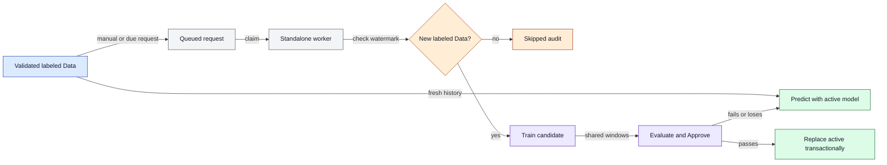

# Background training and optional recurring retraining

Phase 11 adds a durable PostgreSQL queue and one standalone local scheduler/worker. The API only saves requests. Closing the browser does not stop a job. Stopping the worker or sleeping/shutting down the laptop prevents scheduled execution; this is not a cloud service.

## Start it

Use these commands from the repository root in PowerShell or bash:

```text
uv sync --locked
uv run --locked alembic upgrade head
uv run --locked alembic check
uv run --locked python -m retailforecast.lifecycle.job_worker
```

Keep that terminal/process running alongside API/web (`npm run dev`) and Docker PostgreSQL. `--once` checks schedules and processes at most one eligible attempt, then exits. Resource/search limits remain in configs/training.yaml; configs/jobs.yaml selects the worker's dev/full mode, retry/poll/heartbeat limits and catch-up batch bound. Normal API/UI users select only Auto, XGBoost or LightGBM. No GPU, cloud account, Redis, Celery or browser-owned scheduler is introduced.

The home page checks the actual active pointer independently of API health. With no active model, it offers first training and explicitly says forecasts are unavailable. With an incumbent, it offers candidate training and keeps model availability separate from job progress. A queued request waits for the standalone worker; a successful training job does not necessarily mean its candidate replaced the incumbent.

## API examples

All paths start `/api/v1`. Swagger is at http://127.0.0.1:8000/docs; the generated contract is openapi.json.

| Method/path | Meaning |
|---|---|
| POST `/training-jobs` | 202 persisted/deduplicated request; body `{"algorithm":"auto"}` |
| GET `/training-jobs/{id}` | Durable state, stage, message, timestamps, heartbeat/expiry, attempts/retries and result model ID |
| POST `/training-jobs/{id}/cancel` | Cancel queued work, including a pending retry; running/terminal jobs return 409 |
| GET `/retraining-schedule` | Manual/disabled by default; no timer or worker starts |
| PUT `/retraining-schedule` | Idempotently save cadence, timezone, enabled state, algorithm and optional aware anchor |

PowerShell:

```powershell
$job = Invoke-RestMethod -Method Post -Uri 'http://127.0.0.1:8000/api/v1/training-jobs' -ContentType 'application/json' -Headers @{ 'Idempotency-Key' = 'first-training-001' } -Body '{"algorithm":"auto"}'
Invoke-RestMethod -Uri "http://127.0.0.1:8000/api/v1/training-jobs/$($job.id)"
```

Bash:

```bash
curl -sS http://127.0.0.1:8000/api/v1/training-jobs -H 'Content-Type: application/json' -H 'Idempotency-Key: first-training-001' -d '{"algorithm":"auto"}'
```

An idempotency key returns the same job even after completion; reusing it for another algorithm is 409. Concurrent equivalent requests for the same source/algorithm share one pending job. Jobs pin the source version, checksum, baseline model and backend settings when queued; importing again does not silently retarget a queued job. A new request/scheduled check can select the newly imported child. No raw tuning parameters, dataset paths or subprocess arguments are accepted through HTTP.

The response's `state` is queued/running/succeeded/failed/skipped/cancelled. `stage` reports actual work, such as preparing_data/training/registering/evaluating/complete; it never fabricates a percentage. `attempts` retains each failure and retry summary. `worker_heartbeat_stale` and `lease_expires_at` show an expired heartbeat without claiming a read request restarted anything. Full local logs stay in ignored artifacts/jobs/JOB_ID/OWNER_TOKEN.log; structured summaries deliberately omit arbitrary native logs, SQL and credentials.

## New observations are an explicit operator action

The original Rossmann data are static. A model fitted through June 13 already had a dataset containing July 31 labels; those withheld labels are not a newly downloaded update. Retraining requires selected-store labels later than the prior fitting cutoff **and** later than the previously consumed source watermark. A successfully processed source is not repeatedly fitted because another week passed or a different algorithm was selected. Failed requests can retry within their bounded attempt budget; deliberate further attempts require a new request.

Import additional actuals with the operator CLI:

```text
uv run --locked python -m retailforecast.data.import_actuals --base-dataset-id DATASET_UUID --csv PATH_TO_OBSERVED_ACTUALS.csv --provenance "Observed daily sales supplied by the store operator" --dry-run
uv run --locked python -m retailforecast.data.import_actuals --base-dataset-id DATASET_UUID --csv PATH_TO_OBSERVED_ACTUALS.csv --provenance "Observed daily sales supplied by the store operator"
```

Use `--synthetic` for explicit demonstration observations. It labels the imported source as synthetic; it does not generate or claim real new sales. Tests create small synthetic August observations, never fabricate Kaggle labels.

Required CSV columns are Store, Date, DayOfWeek, Sales, Customers, Open, Promo, StateHoliday, SchoolHoliday. This is the strict Rossmann-shaped observed-actuals contract, not a Sales-only upload. Customers remain historical audit fields and never enter predictors. Types, weekday/date consistency, finite nonnegative Sales/Customers, flags and known stores are validated. Each Date must be after the parent's observed-through date and no later than the current UTC date. Reject duplicates, backfills/corrections, missing labels, unknown stores and future actual claims. At most 50,000 additional rows are accepted per import; split larger operator files into sequential child imports.

A validated import preserves checksum-verified raw bytes locally, then copies metadata/history unchanged into an immutable child and adds the new rows in one transaction. Matching unlabeled plans are removed from that child's plan table rather than mislabeled as actuals. Closed-store positive Sales quirks are counted and retained. A separate failed-import audit survives a publication rollback. Repeating the same base/file/provenance returns the same version. Each parent has one application-published next child; after extension, use that latest child as the next base. Divergent branches are rejected rather than silently merged. This phase does not onboard new stores or change historical metadata/availability assumptions.

## Fresh forecasts and retraining are different

| Action | What changes | What stays pinned |
|---|---|---|
| Import validated additional actuals | Immutable source version, provenance and observed-through watermark | Existing source snapshots and model weights |
| Request another forecast | Visible history can include the latest validated descendant available by its cutoff | Active model, saved preprocessing, feature schema and knowledge assumptions |
| Request eligible retraining | New background fit/candidate with data and experiment provenance | Incumbent remains active until checked promotion commits |
| Check unchanged data | A durable `skipped: no new labeled observations` result | No fit, experiment/model version or active-pointer change |

Serving never accepts unrelated newest datasets. It verifies the active model's original dataset binding, follows only the validated append-only chain, and computes shared features using its saved context. Response data identifies the observed source/checksum and `feature_context_dataset_fingerprint` separately from model identity; per-store actual coverage and source dates stay explicit. All horizons use only observations available at the requested cutoff, including when later actuals have been imported. A new import alone never launches training.

## Fixed evaluation and promotion

A retraining request inherits the incumbent's exact chronological development folds and protected final window. During the later refit, **all observations in that protected window are removed from the fitting history**, including lag/rolling inputs, not just y. New legitimate post-window observations can enter fitting. The refit manifest records the protected window, removed count and later fitted-through date. This intentionally creates a missing-history gap in fitting; saved missing-value policies apply. The reserved original real June 14..July 31 benchmark is neither scored nor reused for tuning.

Candidates and incumbents compare their retained cutoff-specific models on identical development windows, horizons, stores and metrics. A certified append-only prefix permits each model's own saved context to encode identical feature values; unrelated datasets or changed knowledge assumptions remain incompatible. Original serving weights are never used to predict backward. Strictly better eligible shared mean-fold RMSPE can activate transactionally; a tie/loss retains the incumbent and records rejection. Genuine insufficient evidence requires explicit approval under the existing lifecycle rules. Fixed old development performance does not establish quality on a newly observed period. Later evaluation/schedule comparisons need matched historical replay, not unrelated run-date scores or naïve comparisons of weekly versus monthly runs.

## D6 - Worker ownership and data checks



**Story:** New observed history can improve forecast inputs without requiring a new fit. A schedule checks whether training has useful new labels.

1. Import a validated append-only child and record its provenance.
2. API/manual or due schedule requests persist in PostgreSQL; only the standalone worker claims them.
3. Skip unchanged sources, otherwise fit/evaluate in an owned child under existing CPU/RAM/time limits.
4. Publish a verified candidate and run the existing transactional approval checks while Predict retains its pinned incumbent.

**Inputs:** validated source/version, algorithm, fixed evaluation context and optional due schedule. **Outputs:** durable job/attempt state, skip/error audit or measured model candidate. **Errors:** failed fitting/publication, absent labels, lost ownership or incompatible evidence retain the incumbent. The diagram omits process supervision, polling and retained-model file checks; those are described below. State/source hashes are actual provenance, not performance scores.

## Schedules and restarts

Example PUT body (choose an anchor appropriate to your local plan):

```json
{"cadence":"weekly","timezone":"Europe/Berlin","enabled":true,"algorithm":"auto","anchor_at":"2026-10-20T09:00:00+02:00"}
```

Manual must have enabled=false. Weekly uses seven-day wall-calendar intervals from the anchor. Monthly and quarterly preserve the anchor day, clamping short months while returning to the original day later; quarterly means every three months from that anchor. Timezones use IANA names. Ambiguous DST times use the first occurrence; nonexistent wall times move forward across the gap. Stored due times are UTC. Initial next_run is strictly after configuration time; identical PUT preserves revision and due time.

The worker advances due time and writes its unique schedule/revision/due trigger in one database transaction. After downtime, older missed occurrences are recorded as skipped and only the latest due check is queued. Catch-up is bounded to 100 events per tick, continuing across ticks for very long downtime. A duplicate pending manual/scheduled request records a skipped due event. Repeated ticks/restarts do not duplicate triggers. A latest due check still skips if no new labeled observations exist. Saving an enabled schedule does not start a worker, wake the laptop or guarantee uptime.

One host file lock plus a persistent PostgreSQL advisory lock admits one standalone worker. A partial unique index permits only one running job. Native training also uses the existing one-job file lock, so a concurrent legacy training CLI cannot fit in parallel. PID plus creation time and opaque attempt token identify owned children, including Windows virtualenv launcher descendants. On restart, verify/stop owned orphans before fencing/requeuing interrupted attempts. A process with a reused PID is not killed. An unverifiable owned process stops recovery for operator inspection. API status reads never steal an expired heartbeat lease.

Retries retain failed attempt records and use a bounded retry delay/count (default two attempts total). Invalid data/ownership failures are terminal; retryable process/I/O failures may requeue. A completed native run is reused after publication interruption. Model publication is idempotent per training job and protected by a unique model-job reference; an already activated version is not promoted twice. Queued-only cancellation avoids partial model registration or unsafe native interruption. Raw/processed snapshots and native artifacts remain local/ignored; back up them and both databases together. This is one-laptop recovery, not distributed scheduling or multi-host PID supervision.

## Browser verification without port conflicts

Browser checks normally start isolated API/web servers on ports 8000/3000. If those ports are occupied, build with API_BASE_URL pointing to a separate API port, then use matching PLAYWRIGHT_API_PORT and PLAYWRIGHT_WEB_PORT values. The API proxy is captured at build time. For example, in PowerShell:

```powershell
$env:API_BASE_URL = 'http://127.0.0.1:8001'
$env:PLAYWRIGHT_API_PORT = '8001'
$env:PLAYWRIGHT_WEB_PORT = '13000'
$env:PLAYWRIGHT_CHANNEL = 'msedge'
npm run build --workspace apps/web
npm run test:e2e --workspace apps/web
```

In bash, prefix both commands with API_BASE_URL=http://127.0.0.1:8001 PLAYWRIGHT_API_PORT=8001 PLAYWRIGHT_WEB_PORT=13000; set PLAYWRIGHT_CHANNEL only if using an installed browser channel. Clear the temporary API_BASE_URL and rebuild for the normal port after this check. The suite starts/stops its own API/web processes and verifies both health and model availability. PLAYWRIGHT_REUSE_API=1 is an explicit opt-in to reuse a known running API instead; leave it unset for current-code integration checks. Test transport mocks cover first-model/queued UI states and do not claim measured forecasts or launch real training.
